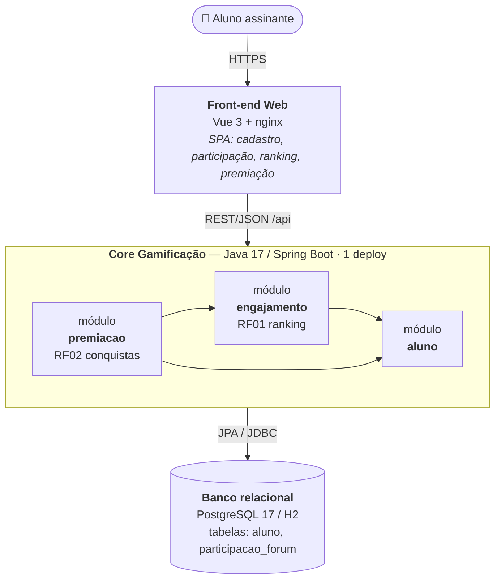
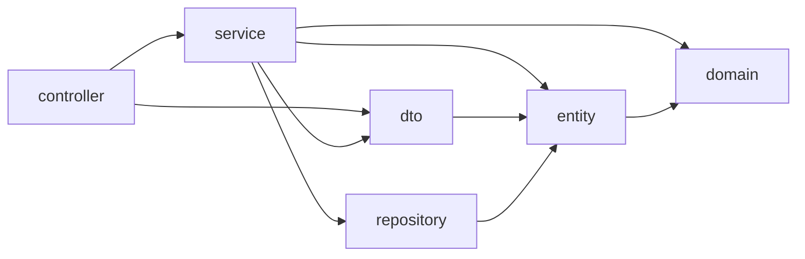
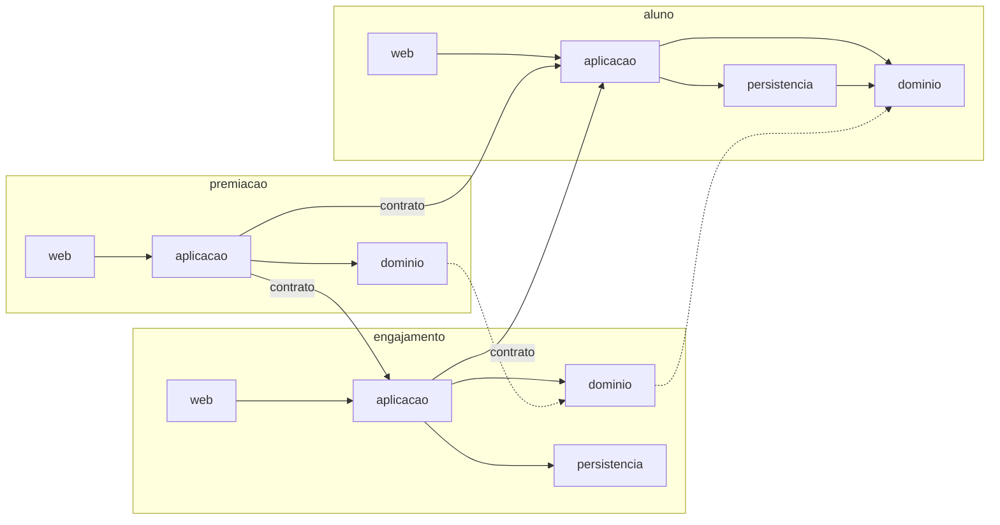
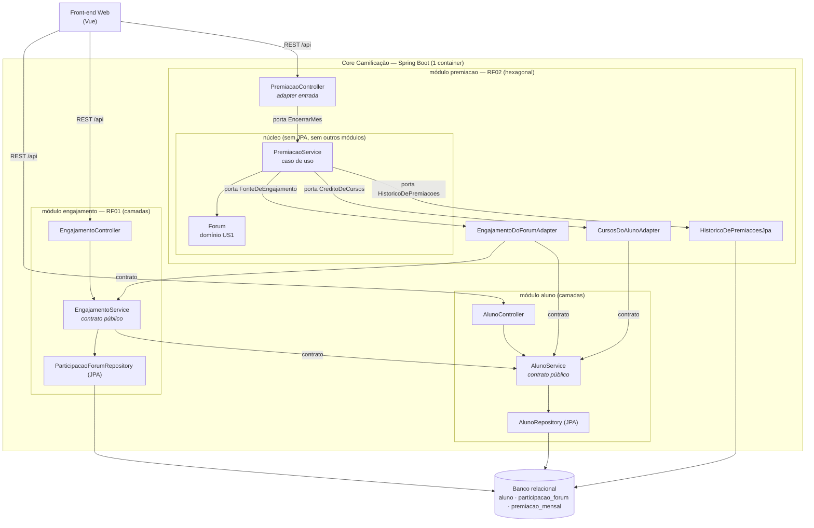
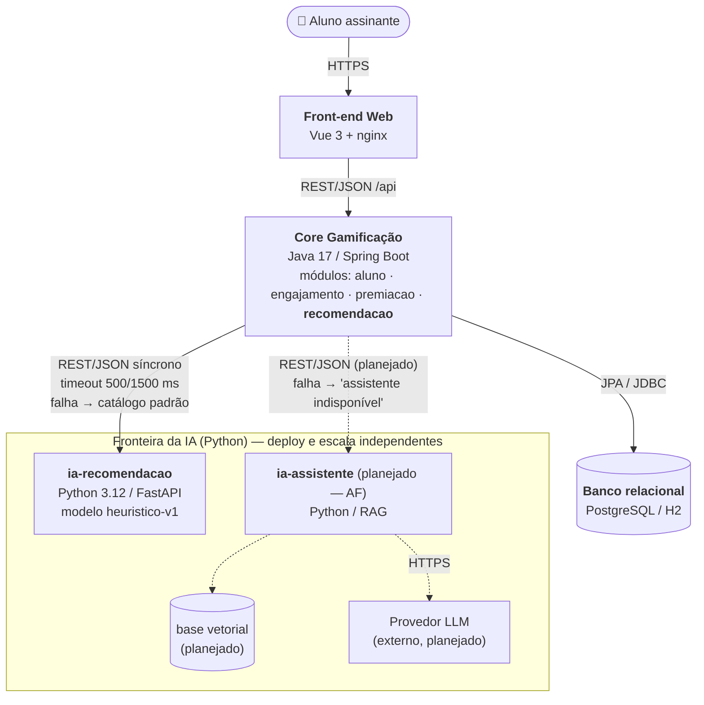
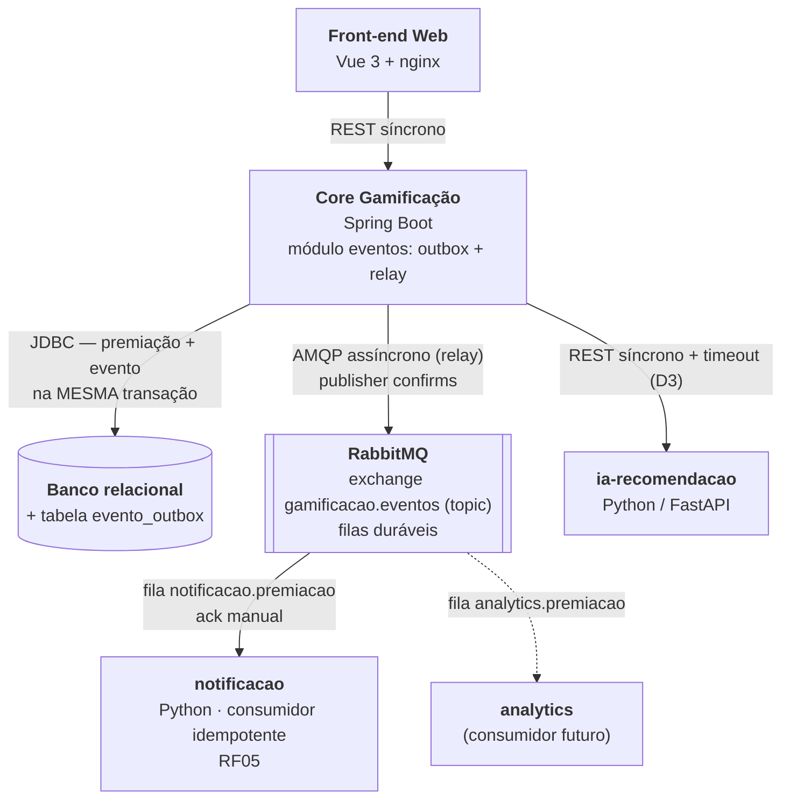
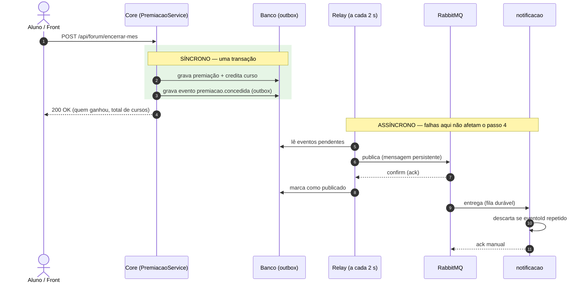
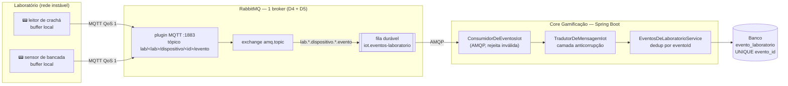
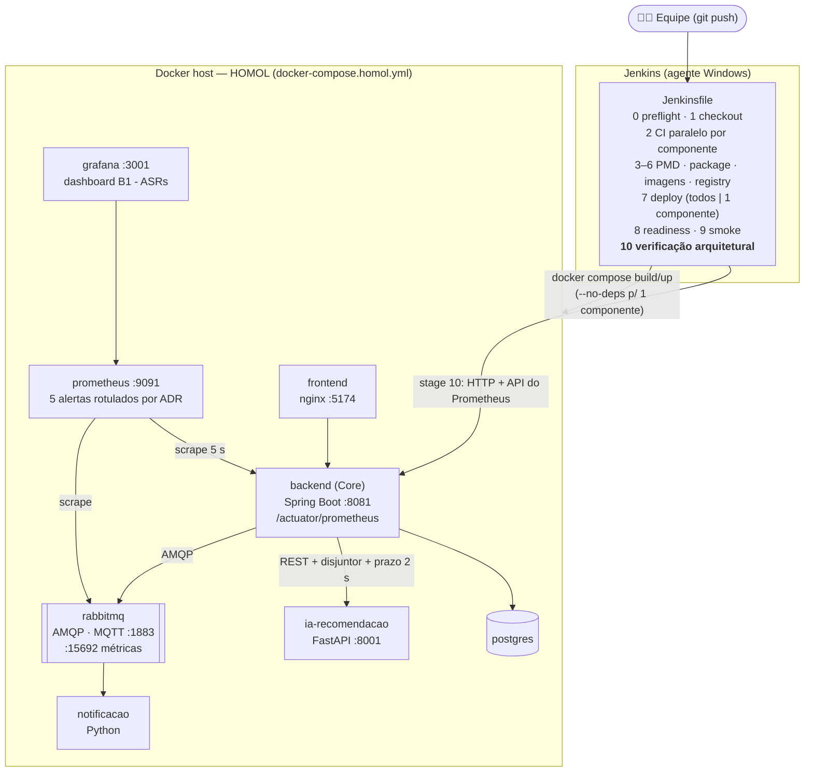
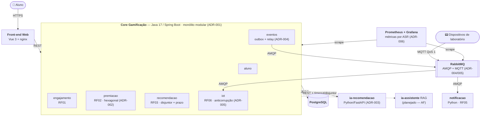

# Registro Arquitetural — B1 Architecture Lab · Grupo 12

Registro **cumulativo** das decisões arquiteturais tomadas sobre o MVP da AC1
(Educação Continuada Gamificada). Cada desafio segue o mesmo roteiro:

> **RF → RNF → ASR + RPC → Alternativas → ADR → C4 → Evidência**
>
> Leitura de trás para frente: o C4 é explicado pelo ADR, o ADR é sustentado pelos ASRs e RPCs,
> os ASRs derivam dos RF/RNF, e a evidência mostra que o raciocínio se sustenta na prática.

**Equipe:** Cauã Tolentino · Pedro Pizzi · Henry Tanaka
**Repositório:** https://github.com/cauatolentino/devopsac1

---

## Índice

| Desafio | Decisão | ADR | Evidência |
|---|---|---|---|
| [1 — Drivers e evolução do Core](#desafio-1--drivers-e-evolução-do-core) | Monólito Modular por capacidade | [ADR-001](../adr/ADR-001-core-monolito-modular.md) | [`evidencias/d1`](evidencias/d1/) |
| [2 — Organização interna do Core](#desafio-2--organização-interna-do-core) | Ports & Adapters só no módulo `premiacao` | [ADR-002](../adr/ADR-002-ports-and-adapters-na-premiacao.md) | [`evidencias/d2`](evidencias/d2/) |
| [3 — Serviço Python e IA](#desafio-3--serviço-python-e-ia) | IA em serviço Python separado (ML e RAG em fronteiras distintas), fallback no Core | [ADR-003](../adr/ADR-003-ia-em-servico-python-separado.md) | [`evidencias/d3`](evidencias/d3/) |
| [4 — Comunicação e eventos](#desafio-4--comunicação-e-eventos) | Premiação síncrona; notificação/analytics assíncronos via Outbox + RabbitMQ | [ADR-004](../adr/ADR-004-outbox-e-rabbitmq-para-notificacoes.md) | [`evidencias/d4`](evidencias/d4/) |
| [5 — IoT e MQTT](#desafio-5--iot-e-mqtt) | MQTT QoS 1 no **mesmo** RabbitMQ (plugin), sem segundo broker; anticorrupção + dedup no Core | [ADR-005](../adr/ADR-005-iot-mqtt-no-rabbitmq-existente.md) | [`evidencias/d5`](evidencias/d5/) |
| [6 — CI/CD e observabilidade](#desafio-6--cicd-e-observabilidade) | Um Jenkinsfile com ciclos por componente + verificação arquitetural em HOMOL; métricas e alertas por ASR | [ADR-006](../adr/ADR-006-pipeline-por-componente-e-metricas-de-asr.md) (+ emenda no ADR-003) | [`evidencias/d6`](evidencias/d6/) |

- [Requisitos funcionais do B1](#requisitos-funcionais-do-b1)
- [Matriz cumulativa de ASRs](#matriz-cumulativa-de-asrs)
- [C4 final da arquitetura](#c4-final-da-arquitetura)
- [Síntese final: o que vai para a PoC da AF](#síntese-final-o-que-vai-para-a-poc-da-af)

---

## Case-base

A plataforma tem ranking, cursos, moedas, badges e recompensas. O Core da AC1 é Java/Spring Boot
com banco relacional e implementa a **US1 — premiação por engajamento no fórum**: o aluno que mais
escreve tópicos e ajuda colegas no mês ganha 1 curso. O produto vai evoluir para múltiplas
instituições, recomendação inteligente, assistente com RAG/LLM, notificações, eventos de
aprendizagem e IoT — sem perder confiabilidade, testabilidade, observabilidade e evolução contínua.

## Requisitos funcionais do B1

| ID | Requisito | Onde está no sistema |
|---|---|---|
| RF01 | Ranking | módulo `engajamento` — `GET /api/forum/engajamento` |
| RF02 | Conquistas / regras de gamificação | módulo `premiacao` — `POST /api/forum/encerrar-mes` |
| RF03 | Recomendação inteligente | módulo `recomendacao` — `GET /api/recomendacoes` → serviço Python `ia-recomendacao` |
| RF04 | Assistente educacional (RAG/LLM) | serviço Python `ia-assistente` — **planejado** (fronteira definida no ADR-003, PoC da AF) |
| RF05 | Notificações | evento `premiacao.concedida` → RabbitMQ → serviço Python `notificacao` |
| RF06 | Receber eventos IoT e encaminhá-los ao ecossistema | dispositivos MQTT → RabbitMQ (plugin) → fila `iot.eventos-laboratorio` → módulo `iot` — `GET /api/laboratorio/eventos` |

## Matriz cumulativa de ASRs

Só entram aqui os RNFs que **mudaram** estrutura, comunicação, dados, implantação ou operação.

| ASR | FURPS+ | Desafio | O que mudou na arquitetura | Evidência |
|---|---|---|---|---|
| Manutenibilidade | Supportability | D1 | Código reorganizado por capacidade (`aluno`, `engajamento`, `premiacao`) com contrato público por módulo | `ArquiteturaModularTest` + jdeps antes/depois |
| Escalabilidade | Performance (capacidade) | D1 | Ranking isolado no módulo `engajamento`, sem depender de `premiacao`: pronto para extração futura | regra `engajamentoNaoConhecePremiacao` |
| Complexidade operacional | + (restrição de implantação) | D1 | Mantido **1 deploy / 1 banco**; extração de serviço adiada até haver medição | ADR-001 (gatilho de revisão) |
| Modificabilidade | Supportability | D2 | Núcleo da premiação cercado por portas: regra muda sem tocar banco/HTTP/outros módulos | regras hexagonais do ArchUnit |
| Testabilidade | Supportability | D2 | Caso de uso testado com adapters falsos, sem Spring nem banco *(no D1 não era ASR: virou driver quando as regras passaram a mudar)* | `PremiacaoServiceUnitarioTest` |
| Facilidade de evolução | Supportability | D2 | Só `adaptador.saida.modulos` conhece outros módulos: ponto único de troca se o ranking virar serviço | regra `soOAdapterDeModulosConheceOsOutrosModulos` |
| Tolerância a falhas | Reliability | D3 | IA em processo separado; timeout de 500/1500 ms; fallback (catálogo padrão) decidido no Core | mini-lab: IA parada, lenta e 503 → HTTP 200 degradado |
| Deploy independente | + (implantação) | D3 | Container e imagem próprios para a IA; Core sem `depends_on` dela | IA recriada sem restart do Core |
| Escalabilidade *(revisitado)* | Performance | D3 | No D1 o Core ficou como 1 deploy; a IA, com carga variável, **é** escalada separadamente | container `ia-recomendacao` |
| Tolerância a falhas *(revisitado)* | Reliability | D4 | Notificação/analytics saem do caminho da requisição: premiação síncrona, entrega assíncrona | encerrar-mês HTTP 200 com consumidor **e** broker fora |
| Recuperabilidade | Reliability | D4 | Outbox antes do broker + filas duráveis depois: evento atrasa, não se perde | broker inalcançável ~3 min → 4 eventos entregues em ordem |
| Consistência | + (dados) | D4 | Evento gravado na mesma transação da premiação (`Propagation.MANDATORY`) | `RegistroDeEventosTest` (fora de transação falha; rollback leva o evento) |
| Tolerância à conectividade intermitente | Reliability | D5 | QoS 1 + buffer no dispositivo + fila durável + dedup por `eventoId` | dispositivo offline 3/3 entregues; Core offline 3/3 processados |
| Eficiência de comunicação | Performance | D5 | MQTT com conexão persistente em vez de HTTP por evento | 209 B (MQTT) × 298 B (HTTP mínimo), sem handshake por evento |
| Interoperabilidade | + (interface) | D5 | Broker como ponte MQTT↔AMQP; camada anticorrupção no Core | `TradutorDeMensagemIot` (13 testes) |
| Deploy independente *(revisitado)* | + (implantação) | D6 | Pipeline com CI paralelo por componente e deploy de um componente só (`--no-deps`) | correção do Core implantada sem reiniciar os outros 8 containers |
| Observabilidade | Supportability | D6 | Actuator + Micrometer + Prometheus + Grafana; métricas e alertas **rotulados por ADR** | alertas `RecomendacaoDegradada` e `OutboxAcumulando` disparando e resolvendo |
| Confiabilidade | Reliability | D6 | Portões que bloqueiam deploy, incluindo **verificação arquitetural em HOMOL** | stages 7–10 verdes; métrica revelou a falha de 8 s e gerou a emenda do ADR-003 |

---

## Desafio 1 — Drivers e evolução do Core

> **Pergunta:** o crescimento para 100.000 usuários justifica distribuir o Core agora, ou uma
> reorganização interna resolve com menor custo?

### 1. RF

| RF | Impacto neste desafio |
|---|---|
| RF01 Ranking | É a funcionalidade que mais cresce em carga — precisa de fronteira própria. |
| RF02 Conquistas | Regras de premiação continuam mudando — não podem arrastar o ranking junto. |
| Funcionalidades da AC1 | Cadastro de aluno, participação, ranking e encerramento do mês devem continuar idênticos para o front-end. |

### 2. RNF — análise

| RNF | FURPS+ | ASR? | Por quê |
|---|---|---|---|
| **Manutenibilidade** | Supportability | **Sim** | Medimos o problema: o `ForumService` da AC1 dependia de 12 classes e misturava 4 responsabilidades; o DTO da API dependia da entidade JPA. Cada capacidade nova pioraria isso. |
| **Escalabilidade** | Performance (capacidade) | **Sim** | O ranking cresce mais que o resto. Ele não precisa escalar sozinho *hoje*, mas precisa estar separado para *poder* escalar sem reescrever o Core. |
| **Complexidade operacional** | + (implantação/operação) | **Sim** | Uma equipe de 6 pessoas passaria a operar rede, contratos, deploys e falhas parciais se introduzíssemos serviços. Essa restrição define quantas unidades de deploy existem. |
| Desempenho | Performance | Não, por enquanto | Não temos medição de latência ou throughput mostrando gargalo. Vira ASR se o Desafio 6 medir problema. |
| Testabilidade | Supportability | Não como driver macro | Já estava em 100% de cobertura na AC1. A modularização a preserva (e o ArchUnit reforça), mas ela não decide entre camadas, módulos e serviços. |

### 3. ASRs selecionados (máx. 3)

1. **Manutenibilidade** → altera a **estrutura**: o código passa a ser organizado por capacidade, não por camada técnica.
2. **Escalabilidade** → altera a **estrutura** e prepara a **implantação**: o ranking fica isolado e com dependências explícitas, pronto para virar serviço se for preciso.
3. **Complexidade operacional** → restringe a **implantação/operação**: continua um único deploy e um único banco.

### 4. RPC

| RPC | Efeito na decisão |
|---|---|
| Core em Java/Spring Boot | Evolução incremental sobre o código existente; nada de reescrita. |
| Equipe de 6 desenvolvedores | Limita o custo operacional aceitável — pesa contra microsserviços agora. |
| Banco relacional | Mantido; módulos compartilham o banco, cada um com suas tabelas. |
| Legado da AC1 | Regras do TDD e cenários BDD têm que continuar passando sem mudar lógica. |

### 5. Alternativas e trade-offs

| Alternativa | Atende os ASRs? | Custo | Veredito |
|---|---|---|---|
| **A — Monólito em camadas (atual)** | Não resolve manutenibilidade (acoplamento medido cresce) nem prepara a escala do ranking. | Nenhum agora; alto depois. | Rejeitada |
| **B — Monólito Modular** | Sim nos três: fronteiras por capacidade, ranking isolado, 1 deploy. | Mais classes/contratos; disciplina de fronteira (automatizada). | **Escolhida** |
| **C — Ranking como serviço separado** | Escala sim, mas viola o ASR de complexidade operacional. | Rede, consistência entre bancos, novo pipeline, monitoramento. | Prematura — sem medição |

**Respostas às perguntas do Tech Lead:**

- *Há necessidade comprovada de escala/deploy independente?* **Não.** O cenário prevê crescimento,
  mas não há métrica mostrando gargalo nem ritmo de deploy diferente.
- *A complexidade distribuída é justificável?* **Ainda não.** Ela atacaria um problema que não
  medimos e criaria outros que sabemos que teremos (rede, falha parcial, dados distribuídos).

### 6. ADR

➡️ **[ADR-001 — Core organizado como Monólito Modular por capacidade](../adr/ADR-001-core-monolito-modular.md)**

Resumo: módulos `aluno`, `engajamento` (RF01) e `premiacao` (RF02), cada um com
`web → aplicacao → dominio/persistencia`; `persistencia` e `web` privadas; dependência em sentido
único `premiacao → engajamento → aluno`; referência entre módulos por id. Gatilho para extrair o
ranking: métrica de latência/carga no Desafio 6.

### 7. C4 — Container

O Core continua sendo **um único container**; a mudança é interna (organização modular).

**Preparação para o Desafio 2:** como a decisão é interna ao Core, o detalhamento por componente
(C4 Component, com responsabilidades e fronteiras de cada módulo) é feito no Desafio 2.

### 8. Evidência — mini-lab de modularização

**Hipótese testada:** *reorganizar a US1 por capacidade torna as dependências explícitas e
controláveis, sem mudar o comportamento e sem introduzir distribuição.*

#### Antes — camadas técnicas (AC1)

`service` alcança tudo. `dto -> entity` acopla o JSON da API à tabela.

#### Depois — módulos por capacidade

Setas cheias entre módulos chegam **só** em `aplicacao`. As pontilhadas são as referências entre
classes de domínio herdadas da AC1 (`Forum → ParticipacaoForum → Aluno`), mantidas para não
reescrever o código do TDD.

#### Comparação medida (jdeps)

| Métrica | Antes | Depois |
|---|---|---|
| Organização | 7 pacotes técnicos | 3 módulos de negócio + `compartilhado` |
| Maior fan-out de uma classe | `ForumService`: **12** dependências | `PremiacaoService`: **8** |
| Responsabilidades da maior classe | 4 (cadastro, participação, ranking, premiação) | 1 (encerrar o mês) |
| Classe de outra capacidade acessando entidade/repositório | **Sim** (`ForumService` acessava os de aluno e de participação) | **0** arestas |
| Contrato da API dependendo de entidade JPA | **Sim** (`dto -> entity`) | **Não** (`web -> aplicacao`) |
| Persistência do ranking amarrada à do aluno | **Sim** (`@ManyToOne`) | **Não** (só `aluno_id`) |
| Ciclos entre módulos | — | **0** (verificado por ArchUnit) |
| Total de arestas classe→classe | 25 | 34 *(custo: mais contratos explícitos)* |
| Regras de fronteira verificadas no build | 0 | **11** |

#### Comportamento preservado

| Verificação | Resultado |
|---|---|
| Suíte antes → depois | 46 → **64 testes**, 0 falhas, JaCoCo **100%** (instrução, linha, branch) |
| Cenários BDD da AC1 (Cucumber) | 8/8 passando, **sem alteração no `.feature`** |
| Testes de domínio do TDD | mesmos testes; só mudou o `package` |
| Contrato OpenAPI (rotas + schemas) | **idêntico** (só as *tags* do Swagger mudaram: 1 por módulo) |
| 15 chamadas HTTP reais, jar antes × jar depois | **respostas idênticas** |

#### Falha simulada — a fronteira é de verdade

Colocamos de propósito um `AlunoRepository` dentro do `PremiacaoService` (o atalho da AC1).
O build **falhou** com a violação apontada. Na primeira tentativa, a regra (`onlyBeAccessed`) não
pegou a simples declaração do campo, e então a reforçamos (`onlyHaveDependentClassesThat`). O
experimento também serviu para validar o próprio teste.

#### Arquivos

| Arquivo | Conteúdo |
|---|---|
| [`01-dependencias-antes.txt`](evidencias/d1/01-dependencias-antes.txt) | jdeps pacote→pacote e classe→classe da AC1 |
| [`02-suite-antes.txt`](evidencias/d1/02-suite-antes.txt) | `mvnw clean verify` antes (46 testes) |
| [`03-dependencias-depois.txt`](evidencias/d1/03-dependencias-depois.txt) | jdeps depois da modularização |
| [`04-suite-depois.txt`](evidencias/d1/04-suite-depois.txt) | `mvnw clean verify` depois (64 testes + ArchUnit) |
| [`05-contrato-api-preservado.txt`](evidencias/d1/05-contrato-api-preservado.txt) | diff do OpenAPI + roteiro HTTP antes/depois |
| [`06-archunit-violacao-simulada.txt`](evidencias/d1/06-archunit-violacao-simulada.txt) | build quebrando com acoplamento proibido |
| [`ArquiteturaModularTest.java`](../../src/test/java/com/example/grupo12_praticaatdd/arquitetura/ArquiteturaModularTest.java) | as 11 regras de fronteira |

### Conclusão do Desafio 1

A US1 foi reorganizada em três módulos sem distribuição e sem nenhuma mudança visível para o
front-end. O mini-lab confirmou a hipótese: as dependências entre capacidades passaram a ser
poucas, explícitas, de sentido único e **verificadas no build**. O que **não** foi comprovado
(e por isso não foi feito) é a necessidade de extrair o ranking: isso depende de métricas de carga
e latência, que serão instrumentadas no Desafio 6.

### Rastreabilidade

| RF | RNF | ASR | RPC | Alternativas | ADR | C4 | Evidência |
|---|---|---|---|---|---|---|---|
| RF01, RF02 | Manutenibilidade, escalabilidade, desempenho, testabilidade, complexidade operacional | Manutenibilidade, escalabilidade, complexidade operacional | Spring Boot, 6 devs, relacional, legado AC1 | Camadas × Modular × Serviço | ADR-001 | Container: Core único, interno modular | jdeps antes/depois, ArchUnit, suíte 100%, contrato idêntico, falha simulada |

---

## Desafio 2 — Organização interna do Core

> **Pergunta:** como evitar que domínio, banco, framework e integrações fiquem acoplados, sem
> reescrever o produto só para aplicar um padrão?

### 1. RF

| RF | Impacto neste desafio |
|---|---|
| RF01 Ranking | É a **fonte** de dados da premiação; pode deixar de ser local (virar serviço). |
| RF02 Conquistas / regras de gamificação | Regras que mais mudam. Ganham uma regra nova: **um mês é premiado uma única vez**. |

### 2. RNF — análise

| RNF | FURPS+ | ASR? | Por quê |
|---|---|---|---|
| **Modificabilidade** | Supportability | **Sim** | Regras de conquista mudam com frequência. Hoje mudar a premiação exige conhecer `EngajamentoService` e `AlunoService`. |
| **Testabilidade** | Supportability | **Sim** | No fim do D1 o caso de uso só era testável com Spring + H2. Regra que muda muito precisa de teste barato. |
| **Facilidade de evolução** | Supportability | **Sim** | O ADR-001 prevê extrair o ranking. A premiação não pode depender de *como* o ranking é obtido. |
| Manutenibilidade | Supportability | Não aqui | Já tratada no D1 (fronteiras entre módulos). Aqui o problema é **dentro** de um módulo. |

### 3. ASRs selecionados (máx. 3)

1. **Modificabilidade** → **estrutura**: o núcleo da premiação fica cercado por portas.
2. **Testabilidade** → **estrutura**: portas permitem adapters falsos no lugar de banco e módulos.
3. **Facilidade de evolução** → **comunicação**: a origem do ranking vira um adapter trocável (hoje chamada em processo, amanhã HTTP).

### 4. RPC

| RPC | Efeito |
|---|---|
| Core continua Spring Boot | Adapters são beans Spring; o núcleo tolera `@Service`/`@Transactional` (sem efeito fora do Spring). |
| Regras existentes reaproveitadas | `Forum`, `ParticipacaoForum` e `Aluno` **não mudaram uma linha** (só o `package`, no D1). |
| Proibido reescrever o produto para aplicar padrão | Hexagonal **só onde dói**: `premiacao`. `aluno` e `engajamento` continuam em camadas. |

### 5. Decisão do Tech Lead

- **Qual dependência realmente precisa ser invertida?** *Caso de uso da premiação → implementações
  externas* (`EngajamentoService`, `AlunoService` e a nova persistência). O domínio já era
  independente de framework desde o D1, e o ArchUnit prova isso.
- **O custo estrutural é proporcional?** Sim: são 4 portas e 4 adapters num único módulo. Aplicar
  em todos os módulos daria portas para CRUD simples, sem retorno.
- **DDD, Hexagonal, Clean e Onion são concorrentes?** Não. DDD define *quais* fronteiras existem
  (nossos módulos são os bounded contexts), Hexagonal define *como* um contexto fala com o mundo,
  e Clean/Onion fornecem a *regra de dependência para dentro*, que adotamos e verificamos.

### 6. Alternativas e trade-offs

| Alternativa | Atende os ASRs? | Custo | Veredito |
|---|---|---|---|
| **A — Camadas dentro do módulo (estado do D1)** | Não: o caso de uso continua preso a implementações concretas e só é testável com Spring + banco. | Zero agora. | Rejeitada |
| **B — Ports & Adapters só em `premiacao`** | Sim nos três. | 8 tipos novos; dois estilos no Core. | **Escolhida** |
| **C — Clean/Hexagonal em todos os módulos** | Sim, mas sem necessidade em `aluno`/`engajamento`. | Alto; viola a RPC de não reescrever. | Desproporcional |

### 7. ADR

➡️ **[ADR-002 — Ports & Adapters apenas no módulo de premiação](../adr/ADR-002-ports-and-adapters-na-premiacao.md)**

### 8. C4 — Component (Core Gamificação)

**Fronteiras relevantes:** o núcleo da premiação só tem setas **saindo por portas**. Os adapters
são os únicos que tocam o mundo externo (outros módulos e banco). Nos módulos `aluno` e
`engajamento`, a persistência continua privada (regra do D1).

### 9. Evidência — mini-lab: isolar a regra e trocar o adapter

**Hipótese testada:** *com portas, a regra da premiação roda e é verificada sem banco e sem os
outros módulos, e a persistência pode ser trocada sem mudar o núcleo.*

| Verificação | Resultado |
|---|---|
| Caso de uso rodando **só com adapters falsos** (`PremiacaoServiceUnitarioTest`) | 5 testes, ~0,01 s, **sem Spring e sem banco** |
| **Mesmo contrato** contra 2 adapters da porta `HistoricoDePremiacoes` | memória (fake) ✅ 3/3 · JPA + H2 ✅ 3/3 |
| Testes de domínio do TDD (`AlunoTest`, `ParticipacaoForumTest`, `ForumTest`) | **idênticos** aos da AC1 (diff com `git HEAD`, ignorando `package`/`import`) |
| Classes de domínio `Aluno`, `ParticipacaoForum`, `Forum` | **idênticas** às da AC1 |
| Defeito "mesmo mês premiado várias vezes" | antes: 3 encerramentos = **3 cursos** · depois: **1 curso** |
| Roteiro HTTP de 15 chamadas do D1 | **respostas idênticas** |
| Dependências do caso de uso | antes: `AlunoService`, `EngajamentoService` · depois: só portas + domínio |
| Falha simulada: recolocar `EngajamentoService` no núcleo | **BUILD FAILURE** em 2 regras |
| Suíte completa | **80 testes**, JaCoCo **100%** |

| Arquivo | Conteúdo |
|---|---|
| [`01-dependencias-premiacao-antes-depois.txt`](evidencias/d2/01-dependencias-premiacao-antes-depois.txt) | jdeps do módulo premiação, D1 × D2 |
| [`02-idempotencia-antes-depois.txt`](evidencias/d2/02-idempotencia-antes-depois.txt) | defeito reproduzido no jar do D1 e corrigido no jar do D2 |
| [`03-troca-de-adapter-testes.txt`](evidencias/d2/03-troca-de-adapter-testes.txt) | contrato contra os 2 adapters + caso de uso com fakes |
| [`04-archunit-violacao-simulada.txt`](evidencias/d2/04-archunit-violacao-simulada.txt) | build quebrando ao desfazer a inversão |
| [`ContratoHistoricoDePremiacoes.java`](../../src/test/java/com/example/grupo12_praticaatdd/premiacao/adaptador/saida/ContratoHistoricoDePremiacoes.java) | contrato da porta (o mesmo teste para cada adapter) |

**Achado no caminho:** na primeira execução, o adapter JPA falhou no contrato porque os testes
herdados rodavam **sem transação** (no Spring 7, o rollback de teste é decidido pela classe que
declara o método). Isso foi corrigido com `@Transactional` no contrato. É um bom exemplo de
detalhe técnico que o adapter traz e que o núcleo nunca precisa saber.

### Conclusão do Desafio 2

A única dependência que precisava ser invertida (caso de uso → implementações externas) foi
invertida no único módulo onde isso se paga. A regra da US1 continua a mesma classe da AC1, agora
testada sem infraestrutura, e a persistência foi trocada (fake ↔ JPA) sem mudar o núcleo. A
modularização ainda revelou e corrigiu um defeito real de regra de negócio.

### Rastreabilidade

| RF | RNF | ASR | RPC | Alternativas | ADR | C4 | Evidência |
|---|---|---|---|---|---|---|---|
| RF01, RF02 | Manutenibilidade, testabilidade, modificabilidade, evolução | Modificabilidade, testabilidade, facilidade de evolução | Spring Boot, reaproveitar regras, sem reescrita | Camadas × Hexagonal em 1 módulo × Clean em todos | ADR-002 | Component do Core | fakes sem Spring, contrato com 2 adapters, domínio idêntico, defeito corrigido, ArchUnit |

---

## Desafio 3 — Serviço Python e IA

> **Pergunta:** onde fica a fronteira da IA para que ela evolua no seu próprio ritmo, e o que
> acontece com a plataforma quando ela cai?

### 1. RF

| RF | Impacto neste desafio |
|---|---|
| RF03 Recomendação inteligente | **Implementado**: `GET /api/recomendacoes?aluno=` no Core → `POST /recomendacoes` no serviço Python. |
| RF04 Assistente educacional (RAG/LLM) | **Fronteira decidida** (serviço próprio `ia-assistente`); implementação na PoC da AF. |

### 2. RNF — análise

| RNF | FURPS+ | ASR? | Por quê |
|---|---|---|---|
| **Tolerância a falhas** | Reliability | **Sim** | A RPC diz que a IA fora do ar não pode bloquear o fluxo essencial. Isso decide processo, timeout e fallback. |
| **Deploy independente** | + (implantação) | **Sim** | Modelos têm ciclo próprio (retreino, nova versão); não podem esperar o release do Core. |
| **Escalabilidade** | Performance | **Sim** | Carga da IA varia de forma diferente do Core e precisa escalar sozinha. |
| Interoperabilidade | + (interface) | Não | REST/JSON entre Java e Python resolve sem esforço; é consequência, não driver. |
| Desempenho | Performance | Não como driver | Vira **restrição**: orçamento de 1,5 s por chamada (timeout). Não muda a estrutura. |
| Manutenibilidade | Supportability | Não aqui | Tratada no D1/D2; o novo módulo segue o mesmo padrão (porta + adapter). |

### 3. ASRs selecionados (máx. 3)

1. **Tolerância a falhas** → **comunicação + estrutura**: chamada síncrona com timeout, falha traduzida no adapter, fallback no caso de uso.
2. **Deploy independente** → **implantação**: imagem e container próprios, com testes no build da imagem.
3. **Escalabilidade** → **implantação/operação**: o container da IA escala sem escalar o Core.

### 4. RPC

| RPC | Efeito |
|---|---|
| Core permanece Java/Spring Boot | IA consumida via HTTP pelo módulo `recomendacao`; nada de Python dentro do Core. |
| ML/RAG utilizam Python | Serviço FastAPI (`ia-recomendacao/`), com pytest. |
| Indisponibilidade da IA não pode bloquear o fluxo essencial | Regra ArchUnit: `aluno`, `engajamento` e `premiacao` **não podem** depender de `recomendacao`. |

### 5. Decisão do Tech Lead

- **Python por si só justifica um serviço?** Não. Justificam os 3 ASRs (falha isolada, deploy
  próprio, escala própria).
- **ML e RAG precisam da mesma fronteira?** Não. Têm latência, custo, dependências (LLM,
  base vetorial) e modos de falha diferentes. Ficam em **serviços separados**:
  `ia-recomendacao` e `ia-assistente`.
- **Quais ASRs justificam autonomia e escala?** Deploy independente e escalabilidade, com
  tolerância a falhas definindo o *como* (timeout + fallback).
- **Qual comportamento degradado é aceitável?** Recomendação → catálogo padrão com
  `degradado: true` (HTTP 200). Assistente → "indisponível no momento". Fluxo essencial → nenhum,
  porque não depende da IA.

### 6. Alternativas e trade-offs

| Alternativa | Tolerância a falhas | Deploy independente | Escala própria | Veredito |
|---|---|---|---|---|
| **A — IA embutida no Core** | ❌ falha/lentidão no mesmo processo | ❌ | ❌ | Rejeitada |
| **B — Módulo acoplado** (lib chamando scripts Python) | ❌ mesmo processo | ❌ mesmo deploy | ❌ | Rejeitada |
| **C — Serviço Python independente** | ✅ timeout + fallback | ✅ imagem própria | ✅ container próprio | **Escolhida** |

**ML e RAG juntos ou separados?** Juntos economizariam um container, mas um pico de uso do
assistente (LLM lento, cota estourada) derrubaria a recomendação junto. **Separados.**

### 7. ADR

➡️ **[ADR-003 — IA em serviço Python separado, com degradação controlada pelo Core](../adr/ADR-003-ia-em-servico-python-separado.md)**

### 8. C4 — Container (fronteira da IA e protocolos)

Linhas pontilhadas = planejado. Nenhuma seta sai da IA em direção ao fluxo essencial: o Core
chama a IA, nunca o contrário.

### 9. Evidência — mini-lab: Spring Boot consumindo FastAPI e a IA caindo

**Hipótese testada:** *com processo separado, timeout e fallback no Core, a IA pode cair, ficar
lenta ou falhar sem afetar o fluxo essencial, e volta sem restart do Core.*

Core rodando (jar, H2) e IA em container. **O Core não foi reiniciado em nenhum passo.**

| # | Situação da IA | `GET /api/recomendacoes` | Origem | Fluxo essencial (ranking / encerrar mês) |
|---|---|---|---|---|
| 1 | no ar | HTTP 200 em **0,11 s** | `ia-recomendacao` (heuristico-v1) | 200 / 200 |
| 2 | **parada** (`docker stop`) | HTTP 200 em **0,016 s** | `catalogo-padrao`, `degradado: true` | 200 / 200 |
| 3 | **lenta** (5 s de latência) | HTTP 200 em **1,51 s** (timeout) | `catalogo-padrao`, `degradado: true` | 200 / 200 |
| 4 | **erro 503** | HTTP 200 em **0,013 s** | `catalogo-padrao`, `degradado: true` | — |
| 5 | **de volta** (novo container) | HTTP 200 em **0,011 s** | `ia-recomendacao` | — |

| Verificação automatizada | Resultado |
|---|---|
| pytest do serviço Python (no `docker build`) | **8 passed**: a imagem só existe se passar |
| Adapter HTTP contra servidor HTTP real: ok, 503, lento, fora do ar, corpo inválido | 5/5 ✅ |
| Caso de uso: perfil enviado, fallback, 404 | 3/3 ✅ |
| Regra `fluxoEssencialNaoDependeDaIa` (falha simulada: premiação chamando a IA) | **BUILD FAILURE** ✅ |
| Suíte completa | **95 testes**, JaCoCo **100%** |

| Arquivo | Conteúdo |
|---|---|
| [`01-minilab-ia-interrompida.txt`](evidencias/d3/01-minilab-ia-interrompida.txt) | os 5 passos com tempos, corpos e log do Core |
| [`02-testes-fronteira-ia.txt`](evidencias/d3/02-testes-fronteira-ia.txt) | pytest + testes Java da fronteira |
| [`03-archunit-fluxo-essencial-sem-ia.txt`](evidencias/d3/03-archunit-fluxo-essencial-sem-ia.txt) | build quebrando se o fluxo essencial depender da IA |
| [`minilab-d3.sh`](evidencias/d3/minilab-d3.sh) | roteiro reproduzível do mini-lab |
| [`ia-recomendacao/`](../../ia-recomendacao/) | código do serviço Python + Dockerfile + testes |

### Conclusão do Desafio 3

A separação foi motivada por tolerância a falhas, deploy independente e escala, e não pela
linguagem. O mini-lab mostrou as três situações de falha (parada, lenta e erro) virando resposta
degradada controlada, com o fluxo essencial intacto e recuperação automática. O ponto fraco
conhecido é que, com a IA **lenta**, cada chamada paga o timeout de 1,5 s. Um circuit breaker
resolveria isso e fica como candidato, condicionado às métricas do Desafio 6.

> **Atualização (Desafio 6):** as métricas justificaram. Em HOMOL, a IA parada gerou chamadas de
> **8 s**, porque a resolução de DNS do container parado não é coberta pelos timeouts. Foram
> implementados um **disjuntor** e um **prazo total de 2 s**, e o pior caso caiu para ~2 s. Veja a
> emenda no [ADR-003](../adr/ADR-003-ia-em-servico-python-separado.md) e o
> [Desafio 6](#desafio-6--cicd-e-observabilidade).

### Rastreabilidade

| RF | RNF | ASR | RPC | Alternativas | ADR | C4 | Evidência |
|---|---|---|---|---|---|---|---|
| RF03, RF04 | Deploy independente, escalabilidade, tolerância a falhas, interoperabilidade, desempenho, manutenibilidade | Tolerância a falhas, deploy independente, escalabilidade | Core Java, IA Python, IA não bloqueia fluxo essencial | Embutida × módulo acoplado × serviço; ML+RAG juntos × separados | ADR-003 | Container com fronteira da IA e protocolos | mini-lab com IA parada/lenta/503/de volta, pytest no build, ArchUnit |

---

## Desafio 4 — Comunicação e eventos

> **Pergunta:** onde o sincronismo é necessário e onde eventos reduzem acoplamento, sem que uma
> notificação que falha impeça a conquista?

**Mapeamento do cenário:** o enunciado fala em "concluir um curso". No nosso Core, o fluxo
equivalente é a **conquista**: encerrar o mês registra a premiação, calcula e credita o curso, e
então deve notificar o aluno e alimentar o analytics.

### 1. RF

| RF | Impacto neste desafio |
|---|---|
| RF02 Conquistas | Registro e crédito do curso: **imediato e consistente**. |
| RF05 Notificações | Avisar o aluno premiado: **pode ser eventual**, mas não pode se perder. |
| Eventos de atividade | `premiacao.concedida` passa a ser um fato publicado, consumido por notificação e analytics. |

### 2. RNF — análise

| RNF | FURPS+ | ASR? | Por quê |
|---|---|---|---|
| **Tolerância a falhas** | Reliability | **Sim** | RPC: a premiação tem que concluir com consumidor externo fora. Tira a notificação do caminho síncrono. |
| **Recuperabilidade** | Reliability | **Sim** | Notificação atrasada é aceitável, **perdida não**. Exige durabilidade antes (outbox) e depois (fila) do broker. |
| **Consistência** | + (dados) | **Sim** | Premiação sem evento (aluno não avisado) ou evento sem premiação (aviso falso) são inaceitáveis: evento na mesma transação. |
| Disponibilidade | Reliability | Não separado | Garantida pela tolerância a falhas: a premiação não depende de nada além do banco. |
| Latência | Performance | Não | A parte síncrona continua em ~15–30 ms; a notificação tolera segundos. |
| Desacoplamento | Supportability | Não (consequência) | Vem de graça com eventos; não muda a decisão sozinho. |

### 3. ASRs selecionados (máx. 3)

1. **Tolerância a falhas** → **comunicação**: notificação/analytics passam a ser assíncronos.
2. **Recuperabilidade** → **dados + operação**: tabela outbox, relay com retry, filas duráveis.
3. **Consistência** → **dados + estrutura**: Transactional Outbox, com evento na mesma transação.

### 4. RPC

| RPC | Efeito |
|---|---|
| Operações essenciais concluem com consumidor externo indisponível | Nenhuma chamada a broker/consumidor dentro da requisição; o Core sobe sem broker (sem `depends_on`). |
| Broker exige custo operacional | Um broker só (RabbitMQ), topologia mínima (1 exchange, 2 filas); Kafka rejeitado por custo sem problema correspondente. |

### 5. Decisão do Tech Lead

| Pergunta | Resposta |
|---|---|
| Qual resposta precisa ser imediata? | Resultado da premiação (quem ganhou, total de cursos), em **REST síncrono** e numa transação. |
| Qual pode ser eventual? | Notificação ao aluno e analytics. |
| Que ASR justificaria mensageria? | **Recuperabilidade com 2+ consumidores independentes**. Com 1 só, outbox + retry bastariam. |
| RabbitMQ/Kafka resolvem um problema real? | RabbitMQ sim (filas duráveis, fan-out, ack). Kafka resolveria replay/streaming, que o caso não tem. |

### 6. Alternativas e trade-offs

| Alternativa | Consumidor fora | Broker fora | Consistência | Veredito |
|---|---|---|---|---|
| **A — REST síncrono** dentro do encerrar-mês | premiação falha ou paga timeout (~1,5 s, medido no D3) | — | — | Rejeitada |
| **B — Evento em memória** (`@Async`) | ok | processo cai = perdido | ❌ | Rejeitada |
| **C — Publicar no RabbitMQ após o commit** | ok (fila durável) | **perdido** | ❌ | Rejeitada |
| **D — Outbox + relay + RabbitMQ** | ok | ok (espera no outbox) | ✅ | **Escolhida** |
| **E — Outbox + Kafka** | ok | ok | ✅ | Custo sem problema que justifique |

### 7. ADR

➡️ **[ADR-004 — Premiação síncrona; notificação e analytics por eventos (Outbox + RabbitMQ)](../adr/ADR-004-outbox-e-rabbitmq-para-notificacoes.md)**

### 8. C4 — Container + sequência do fluxo crítico

### 9. Evidência — mini-lab: síncrono × assíncrono com consumidor e broker fora

**Hipótese testada:** *com outbox e filas duráveis, a premiação (síncrona) não é afetada por
falhas do consumidor ou do broker, e nenhuma notificação se perde, só atrasa.*

Core, broker e consumidor em containers na mesma rede Docker.

| # | Situação | `POST /encerrar-mes` (síncrono) | Fila `notificacao.premiacao` | Notificação |
|---|---|---|---|---|
| 1 | tudo no ar | HTTP 200 em **0,025 s** | 0 (consumida na hora) | enviada em < 2 s |
| 2 | **consumidor parado** | HTTP 200 em **0,032 s** | **1 mensagem esperando** | enviada quando o consumidor voltou |
| 3 | **broker parado** | HTTP 200 em **0,027 s** | broker fora; evento **no outbox** (7 tentativas do relay) | entregue e enviada quando o broker voltou |
| — | fila `analytics.premiacao` | — | acumulou **4** mensagens (sem consumidor) | fan-out funcionando |

**Achado do caminho (registrado em `02-achado-...txt`):** na primeira execução, o RabbitMQ recém
criado ficou **inalcançável por ~3 minutos** por uma particularidade do Docker Desktop desta
máquina. Isso virou um teste real de recuperabilidade: 4 encerramentos responderam HTTP 200
normalmente, e quando o broker ficou alcançável os **4 eventos foram entregues em ordem**, sem
perda. Também apareceram e foram corrigidos 2 defeitos nossos: o consumidor morria com
`socket.gaierror` e o healthcheck usava `ping`, que responde antes da porta AMQP abrir.

| Verificação automatizada | Resultado |
|---|---|
| Fora de transação, registrar evento **falha**; rollback leva o evento junto | ✅ `RegistroDeEventosTest` |
| Relay: entrega em ordem; broker fora mantém pendente com o erro; volta e entrega | ✅ `RelayDoOutboxTest` |
| Publicador exige confirmação; sem ack, a falha sobe | ✅ `PublicadorRabbitMqTest` |
| Premiação publica **1** evento; mês vazio e repetição **não** publicam | ✅ `PremiacaoServiceUnitarioTest` |
| Consumidor: mesmo evento 2× → 1 notificação | ✅ pytest (3 passed no build) |
| Só `eventos.rabbit` conhece o AMQP; o núcleo da premiação não conhece outbox/broker | ✅ ArchUnit (22 regras) |
| Suíte completa | **112 testes**, JaCoCo **100%** |

| Arquivo | Conteúdo |
|---|---|
| [`01-minilab-sincrono-x-assincrono.txt`](evidencias/d4/01-minilab-sincrono-x-assincrono.txt) | os 3 cenários com tempos, filas e log do consumidor e do relay |
| [`02-achado-broker-inalcancavel-sem-perda.txt`](evidencias/d4/02-achado-broker-inalcancavel-sem-perda.txt) | broker inalcançável ~3 min, 0 eventos perdidos, defeitos corrigidos |
| [`03-testes-eventos.txt`](evidencias/d4/03-testes-eventos.txt) | testes do outbox, relay, publicador e consumidor |
| [`minilab-d4.sh`](evidencias/d4/minilab-d4.sh) | roteiro reproduzível |
| [`notificacao/`](../../notificacao/) | serviço consumidor (Python) |

### Conclusão do Desafio 4

A resposta que o aluno precisa na hora continua síncrona e consistente. Só o que pode ser
eventual virou evento. O mini-lab mostrou a premiação respondendo em ~30 ms com o consumidor fora
e com o broker fora. Mostrou também, inclusive num incidente real de ambiente, que o outbox e as
filas duráveis transformam falha em atraso, não em perda. O preço é consistência eventual, a
possibilidade de duplicatas (tratada com consumidor idempotente) e mais um componente para operar.

### Rastreabilidade

| RF | RNF | ASR | RPC | Alternativas | ADR | C4 | Evidência |
|---|---|---|---|---|---|---|---|
| RF02, RF05, eventos | Tolerância a falhas, disponibilidade, latência, consistência, desacoplamento, recuperabilidade | Tolerância a falhas, recuperabilidade, consistência | Essencial conclui sem consumidor; broker tem custo | REST × @Async × publish direto × Outbox+RabbitMQ × Outbox+Kafka | ADR-004 | Container + sequência do fluxo crítico | consumidor e broker parados com HTTP 200, 0 perda, testes de outbox/relay/idempotência |

---

## Desafio 5 — IoT e MQTT

> **Pergunta:** como fazer eventos de dispositivos limitados e instáveis entrarem na plataforma
> sem acoplar o Core a cada dispositivo, e sem multiplicar brokers?

### 1. RF

| RF | Impacto |
|---|---|
| RF06 Receber eventos IoT e encaminhá-los ao ecossistema | Presença, início e conclusão de atividade entram por MQTT, são traduzidos e ficam disponíveis em `GET /api/laboratorio/eventos`. |

### 2. RNF — análise

| RNF | FURPS+ | ASR? | Por quê |
|---|---|---|---|
| **Tolerância à conectividade intermitente** | Reliability | **Sim** | RPC: a conexão cai. Decide QoS, buffer no dispositivo, fila durável e dedup. |
| **Eficiência de comunicação** | Performance | **Sim** | RPC: hardware limitado. Decide o protocolo (MQTT, conexão persistente). |
| **Interoperabilidade** | + (interface) | **Sim** | Dispositivos falam MQTT, o Core fala AMQP/Java. Decide a ponte (broker) e a camada anticorrupção. |
| Disponibilidade | Reliability | Não separado | Coberta pela fila durável: Core fora não perde evento. |
| Escalabilidade | Performance | Não agora | Poucos laboratórios. Vira **gatilho** para um broker MQTT dedicado. |
| Segurança de integração | + (segurança) | Não como driver do lab | Registrada como trade-off: credencial por dispositivo, TLS 8883 e ACL de tópico para produção. |

### 3. ASRs selecionados (máx. 3)

1. **Tolerância à conectividade intermitente** → **comunicação + operação**: QoS 1, buffer local, fila durável, `eventoId` para dedup.
2. **Eficiência de comunicação** → **protocolo**: MQTT com conexão TCP persistente em vez de HTTP por evento.
3. **Interoperabilidade** → **integração**: RabbitMQ faz a ponte MQTT→AMQP, e o Core traduz na camada anticorrupção.

### 4. RPC

| RPC | Efeito |
|---|---|
| Dispositivos com baixo poder computacional | Cliente MQTT leve; payload JSON compacto; nada de HTTP/TLS por evento. |
| Conectividade intermitente | Buffer limitado no dispositivo (descarta o mais antigo quando cheio, e conta); QoS 1. |
| Protocolo e broker adicionam componentes | **Nenhum broker novo**: plugin MQTT no RabbitMQ do D4 (só a porta 1883 e o arquivo `enabled_plugins`). |

### 5. Decisão do Tech Lead

| Pergunta | Resposta |
|---|---|
| REST é suficiente? | Não aqui: cada dispositivo reimplementaria retry/buffer/TLS, e o Core ficaria exposto a todos. |
| O que o MQTT resolve especificamente? | Conexão persistente, QoS 1 com PUBACK, pub/sub por tópico (dispositivo não conhece o Core). |
| Após MQTT, há motivo para outro broker? | **Não**: o RabbitMQ já operado tem plugin MQTT oficial. Segundo broker só com ASR de escala. |
| Como impedir duplicidade ou perda? | Perda: QoS 1, buffer local e fila durável. Duplicidade: `eventoId` do dispositivo e dedup no Core. Inválida: rejeita sem reenfileirar. |

### 6. Alternativas e trade-offs

| Alternativa | Veredito |
|---|---|
| **A — REST direto** | Rejeitada: não trata intermitência nem eficiência; acopla o Core aos dispositivos. |
| **B — Mosquitto + consumidor** | Funciona, mas é **um broker a mais** (e uma ponte para a mensageria interna) sem ganho no volume atual. |
| **B' — MQTT no RabbitMQ existente + consumidor no Core** | **Escolhida**: mesmos benefícios de B, sem componente novo. |
| **C — MQTT dedicado + integração com mensageria interna** | Só com ASR de escala (milhares de dispositivos, QoS 2, cluster MQTT): gatilho de revisão. |

### 7. ADR

➡️ **[ADR-005 — Dispositivos IoT via MQTT no RabbitMQ já existente (sem segundo broker)](../adr/ADR-005-iot-mqtt-no-rabbitmq-existente.md)**

### 8. C4 — Container (dispositivos, broker, consumidor e Core) + fluxo do evento

Nenhuma seta liga um dispositivo ao Core: o acoplamento é só com o **tópico** e a **fila**.

### 9. Evidência — mini-lab: simulador → MQTT → consumidor que transforma o evento

**Hipótese testada:** *com MQTT QoS 1, buffer local, fila durável e dedup, eventos de
dispositivos instáveis entram na plataforma sem perda e sem duplicata, usando o broker que já
existe.*

Simulador (`iot-simulador/`, Python + paho-mqtt) e Core em containers; RabbitMQ com
`rabbitmq_mqtt` ativo (listeners: amqp, **mqtt**, http, prometheus).

| # | Cenário | Resultado no Core |
|---|---|---|
| 1 | dispositivo online: presença → início → conclusão | **3/3** registrados (PUBACK em todos) |
| 2 | **conexão cai**: 3 eventos no buffer local, depois reconecta | **4/4** registrados, **em ordem** |
| 3 | **mesmo `eventoId` enviado 2×** (reentrega QoS 1) | 1 registrado, 1 **"DUPLICATA descartada"** |
| 3b | dispositivo **religado** 2× (novo boot) | **6/6** registrados (nada confundido com duplicata) |
| 4 | **payload inválido** seguido de um válido | inválido **rejeitado**; o válido registrado; fila em 0 |
| 5 | **Core parado** enquanto o dispositivo publica | fila segurou **3**; Core voltou e processou **3/3** |
| 6 | tamanho do mesmo evento | MQTT **209 B** × HTTP mínimo **298 B** (−30%), sem handshake por evento |

**Achado do caminho:** na primeira versão, o `eventoId` era `dispositivo-sequência`. Um
dispositivo religado repetia ids, e com o banco persistente **eventos novos seriam descartados
como duplicata** (perda silenciosa). Corrigimos para `dispositivo-boot-sequência`, com teste novo
e o cenário 3b no lab.

| Verificação automatizada | Resultado |
|---|---|
| Camada anticorrupção: tópico inválido (5 casos) e payload inválido (6 casos) rejeitados; dispositivo lido do tópico, não do payload | ✅ 13 testes |
| Dedup: mesmo `eventoId` 2× = 1 registro; ordem cronológica | ✅ |
| Consumidor rejeita inválida **sem reenfileirar** | ✅ |
| Simulador: buffer em ordem, buffer cheio descarta o mais antigo, boot novo não repete id | ✅ pytest 6 passed (no build) |
| Fluxo essencial não depende de `iot`; núcleo do `iot` não conhece MQTT/AMQP/JSON | ✅ ArchUnit (25 regras) |
| Suíte completa | **135 testes**, JaCoCo **100%** |

| Arquivo | Conteúdo |
|---|---|
| [`01-minilab-mqtt-para-core.txt`](evidencias/d5/01-minilab-mqtt-para-core.txt) | os 7 cenários com publicações, logs do Core e consultas |
| [`02-achado-eventoid-apos-religamento.txt`](evidencias/d5/02-achado-eventoid-apos-religamento.txt) | o defeito de id após reboot e a correção |
| [`03-testes-iot.txt`](evidencias/d5/03-testes-iot.txt) | testes do módulo `iot` e do simulador |
| [`minilab-d5.sh`](evidencias/d5/minilab-d5.sh) | roteiro reproduzível |
| [`iot-simulador/`](../../iot-simulador/) · [`docker/rabbitmq/enabled_plugins`](../../docker/rabbitmq/enabled_plugins) | simulador e configuração do plugin |

### Conclusão do Desafio 5

O MQTT resolveu o lado do dispositivo (conexão persistente, QoS 1, buffer), e a pergunta "precisa
de outro broker?" teve resposta **não**: o RabbitMQ do D4 fala MQTT com os dispositivos e AMQP
com o Core. O mini-lab cobriu queda de conexão, Core fora, duplicata, payload inválido e reboot,
sem perda e sem duplicata. Pendências conscientes: segurança de produção (TLS, credencial e ACL
por dispositivo), DLQ para mensagens rejeitadas e um broker MQTT dedicado se a escala exigir.

### Rastreabilidade

| RF | RNF | ASR | RPC | Alternativas | ADR | C4 | Evidência |
|---|---|---|---|---|---|---|---|
| RF06 | Interoperabilidade, eficiência, disponibilidade, intermitência, escalabilidade, segurança | Intermitência, eficiência, interoperabilidade | Hardware limitado, rede instável, broker tem custo | REST × Mosquitto+consumidor × plugin MQTT no RabbitMQ × MQTT dedicado | ADR-005 | Container com dispositivos, broker, consumidor, Core + fluxo | 7 cenários (offline, Core fora, duplicata, reboot, inválido), 13 testes da anticorrupção, pytest |

---

## Desafio 6 — CI/CD e observabilidade

> **Pergunta:** a arquitetura dos Desafios 1–5 consegue ser construída, implantada e observada
> com segurança, e as decisões se sustentam **rodando**?

### 1. RF

Todos os RFs impactados (RF01–RF06), mais a **operação e evolução** da solução: Core Java,
`ia-recomendacao`, `notificacao`, simulador IoT, RabbitMQ, PostgreSQL e front.

### 2. RNF — análise

| RNF | FURPS+ | ASR? | Por quê |
|---|---|---|---|
| **Deploy independente** | + (implantação) | **Sim** | O ADR-003 prometeu que a IA evolui sem redeploy do Core. A esteira tem que entregar isso. |
| **Observabilidade** | Supportability | **Sim** | Os ASRs anteriores (degradação, outbox, IoT, gatilho do ranking) só são verificáveis com métricas próprias. |
| **Confiabilidade** | Reliability | **Sim** | Define o que **bloqueia** deploy, inclusive provar os ADRs no ambiente implantado. |
| Testabilidade | Supportability | Não (já resolvida) | Vira **portão**: JUnit, BDD, ArchUnit, JaCoCo 100%, pytest no build. |
| Recuperabilidade | Reliability | Não (já resolvida) | Vira **métrica e alerta** (`outbox_pendentes`, `OutboxAcumulando`). |
| Desempenho | Performance | Não como driver | Vira **métrica e gatilho** (p95 do ranking, `RankingLento`, ADR-001). |

### 3. ASRs selecionados (máx. 3)

1. **Deploy independente** → **implantação**: CI paralelo por componente e deploy de um componente só.
2. **Observabilidade** → **operação**: Actuator, Micrometer, Prometheus, Grafana e alertas versionados com rótulo `adr`.
3. **Confiabilidade** → **implantação**: portões, mais o stage *Verificação arquitetural em HOMOL*.

### 4. RPC

| RPC | Efeito |
|---|---|
| Jenkins é a base da esteira | O Jenkinsfile da AC1 foi **evoluído**, não substituído; validado no linter declarativo oficial. |
| Prometheus/Grafana são as ferramentas do lab | Containers no compose de dev e de HOMOL; datasource e dashboard provisionados por arquivo. |
| Artefatos e configurações versionados | `Jenkinsfile`, `docker/prometheus/*.yml`, `docker/grafana/**`, `docker/rabbitmq/enabled_plugins`, `docker-compose*.yml`. |

### 5. Decisão do Tech Lead

| Pergunta | Resposta |
|---|---|
| Serviços independentes exigem pipelines independentes? | Exigem **ciclos** independentes. Num monorepo de equipe única, um Jenkinsfile com CI paralelo e `COMPONENTE=<serviço>` (deploy `--no-deps`) entrega isso. Gatilho para separar: times donos diferentes ou cadências muito diferentes. |
| O que deve bloquear deploy? | JUnit + BDD, **ArchUnit**, JaCoCo 100%, pytest no build das imagens, readiness, smoke E2E e **verificação arquitetural em HOMOL** (ADR-002, 003 e 004 testados no ambiente). |
| Quais métricas validam ASRs anteriores? | `gamificacao_recomendacao_total{origem}` e `…_ia_seconds` (ADR-003), `gamificacao_outbox_pendentes` (ADR-004), `gamificacao_iot_eventos_total{resultado}` (ADR-005), p95 de `/api/forum/engajamento` (gatilho do ADR-001). |
| Métrica técnica × evidência arquitetural? | Técnica descreve o sistema (heap, req/s). **Evidência** é uma métrica com uma **hipótese de ADR amarrada**: o que deveria acontecer e o que significa se não acontecer. Cada alerta tem o rótulo `adr`. |

### 6. Alternativas e trade-offs

| Alternativa | Deploy independente | Manutenção | Verifica o conjunto | Veredito |
|---|---|---|---|---|
| **A — Pipeline único sequencial** (AC1) | ❌ tudo rebuilda/redeploya | ✅ | ✅ | Rejeitada |
| **B — Um pipeline por componente** | ✅ | ❌ duplicação de preflight/HOMOL/smoke | ❌ | Prematura para 1 equipe |
| **C — Um Jenkinsfile, CI paralelo + deploy por componente** | ✅ | ✅ | ✅ (stage 10) | **Escolhida** |

| Métricas | Prova os ASRs? | Veredito |
|---|---|---|
| Só *health check* (AC1) | ❌ "está no ar" não diz se a degradação ou o outbox funcionam | Insuficiente |
| Métricas automáticas (JVM, HTTP) | ⚠️ parcial (p95 sim; degradação e outbox não) | Mantidas, mas não bastam |
| **Métricas próprias por ASR + alertas rotulados por ADR** | ✅ | **Escolhida** |

### 7. ADR

➡️ **[ADR-006 — Um Jenkinsfile com ciclos por componente; métricas que validam ASRs](../adr/ADR-006-pipeline-por-componente-e-metricas-de-asr.md)**
➡️ **[Emenda do ADR-003](../adr/ADR-003-ia-em-servico-python-separado.md#emenda--2026-11-04-desafio-6-a-métrica-derrubou-uma-premissa)**: disjuntor + prazo total, motivados pela métrica

### 8. C4 — Deployment (HOMOL)

### 9. Evidência — mini-lab: Jenkinsfile evoluído, métricas e condições provocadas

**Hipótese testada:** *a esteira entrega cada componente com portões de qualidade, e as métricas
de ASR mostram, em HOMOL, se as decisões dos ADRs se sustentam.*

| Verificação | Resultado |
|---|---|
| Jenkinsfile no **linter declarativo oficial** (Jenkins LTS em container) | ✅ *successfully validated* (controle negativo rejeitado) |
| Stages **7–10** executados contra o HOMOL real (9 containers) | ✅ deploy, readiness, smoke e **verificação arquitetural** (ADR-002, 003, 004 e coleta) |
| Condição provocada 1: **IA parada** | 100% degradado, **0** respostas 5xx, alerta `RecomendacaoDegradada` **firing** |
| Condição provocada 2: **broker parado** | premiação HTTP 200 (~25 ms), `outbox_pendentes = 3`, readiness **UP**, alerta `OutboxAcumulando` **firing** |
| Broker de volta | `outbox_pendentes = 0`, alertas resolvidos, as **3** notificações entregues |
| Configuração de observabilidade | `promtool`: config ✅, 5 regras ✅; dashboard JSON ✅ |
| Suíte completa | **143 testes**, JaCoCo **100%** |

#### A métrica derrubou uma premissa (e a esteira entregou a correção)

| | 1ª chamada com IA parada | demais | Como chegou ao HOMOL |
|---|---|---|---|
| Antes (só timeouts do D3) | **8,2 s** (DNS não coberto) | ~20 ms (cache de DNS) | — |
| + disjuntor | 8,2 s, mas só 1× a cada 30 s | ~15 ms | deploy **só do Core** |
| + prazo total de 2 s | **≤ 2,1 s** | ~15 ms | deploy **só do Core** |

O smoke test **não** detectaria isso, porque a resposta sempre foi HTTP 200. Quem mostrou foi o
painel de latência da IA, ou seja, a **diferença entre métrica técnica e evidência
arquitetural** na prática. Prints: [antes](evidencias/d6/grafana-1-antes-do-disjuntor-ia-8s.jpg)
· [depois](evidencias/d6/grafana-2-depois-disjuntor-e-prazo-2s.jpg).

| Arquivo | Conteúdo |
|---|---|
| [`01-jenkinsfile-validado.txt`](evidencias/d6/01-jenkinsfile-validado.txt) | linter oficial + controle negativo |
| [`02-pipeline-stages-7-a-10-homol.txt`](evidencias/d6/02-pipeline-stages-7-a-10-homol.txt) | deploy, health, smoke e verificação arquitetural |
| [`03-minilab-condicoes-observaveis.txt`](evidencias/d6/03-minilab-condicoes-observaveis.txt) | IA e broker parados, alertas disparando e resolvendo |
| [`04-metrica-derrubou-premissa-adr003.txt`](evidencias/d6/04-metrica-derrubou-premissa-adr003.txt) | 8 s → 2 s, deploy independente da correção |
| [`05-testes-observabilidade.txt`](evidencias/d6/05-testes-observabilidade.txt) | testes do disjuntor, prazo e métricas |
| [`Jenkinsfile`](../../Jenkinsfile) · [`docker/prometheus/`](../../docker/prometheus/) · [`docker/grafana/`](../../docker/grafana/) | configuração versionada |

### Conclusão do Desafio 6

A esteira passou a tratar cada componente como um ciclo próprio, sem perder a verificação do
conjunto. A observabilidade foi desenhada a partir dos ASRs, e não do que o framework exporta por
padrão, e se pagou no próprio desafio: revelou que o ADR-003 tinha uma premissa falsa em
ambiente real. A correção entrou por deploy independente e foi registrada como **emenda** do ADR.
O registro arquitetural é vivo: o ADR foi corrigido, não apagado.

### Rastreabilidade

| RF | RNF | ASR | RPC | Alternativas | ADR | C4 | Evidência |
|---|---|---|---|---|---|---|---|
| RF01–RF06 + operação | Observabilidade, deploy independente, confiabilidade, testabilidade, recuperabilidade, desempenho | Deploy independente, observabilidade, confiabilidade | Jenkins, Prometheus/Grafana, tudo versionado | Pipeline único × por componente × único com ciclos por componente; health × métricas de ASR | ADR-006 (+ emenda ADR-003) | Deployment de HOMOL + C4 final | linter, stages 7–10 verdes, IA e broker parados com alertas, 8 s → 2 s |

---

## C4 final da arquitetura

Visão de **Container** depois das seis decisões (o detalhamento do Core está no C4 Component do
[Desafio 2](#8-c4--component-core-gamificação), e a implantação no C4 Deployment do
[Desafio 6](#8-c4--deployment-homol)).

| ADR | Decisão | Status |
|---|---|---|
| [ADR-001](../adr/ADR-001-core-monolito-modular.md) | Core como monólito modular por capacidade | Aceito |
| [ADR-002](../adr/ADR-002-ports-and-adapters-na-premiacao.md) | Ports & Adapters só no módulo de premiação | Aceito |
| [ADR-003](../adr/ADR-003-ia-em-servico-python-separado.md) | IA em serviço Python separado; degradação no Core | Aceito, **emendado no D6** |
| [ADR-004](../adr/ADR-004-outbox-e-rabbitmq-para-notificacoes.md) | Premiação síncrona; notificação por Outbox + RabbitMQ | Aceito |
| [ADR-005](../adr/ADR-005-iot-mqtt-no-rabbitmq-existente.md) | IoT por MQTT no RabbitMQ existente | Aceito |
| [ADR-006](../adr/ADR-006-pipeline-por-componente-e-metricas-de-asr.md) | Jenkinsfile com ciclos por componente; métricas de ASR | Aceito |

---

## Síntese final: o que vai para a PoC da AF

| Levar para a AF | Por quê (evidência) |
|---|---|
| **Core monólito modular** com fronteiras no build (ArchUnit, 25 regras) | Barrou as 3 violações simuladas (D1, D2, D3); contrato da API preservado; 143 testes, 100%. |
| **Hexagonal só onde a regra muda** (premiação) | Caso de uso testado sem Spring; adapter trocado (fake ↔ JPA); defeito de premiação repetida corrigido. |
| **IA fora do Core**, com degradação decidida pelo Core | IA parada, lenta ou com 503 → HTTP 200; com disjuntor + prazo, pior caso de ~2 s. |
| **Outbox + RabbitMQ** para o que pode ser eventual | Consumidor fora e broker fora com 0 eventos perdidos. |
| **MQTT no mesmo broker** para IoT | 7 cenários sem perda e sem duplicata; nenhum componente novo. |
| **Esteira por componente + verificação arquitetural + métricas de ASR** | Pegou uma premissa falsa (8 s) que o smoke test não via. |

**Pendências conscientes para a AF** (registradas nos ADRs):

1. implementar o **`ia-assistente` (RAG)** na fronteira já definida;
2. segurança de produção no IoT: TLS 8883, credencial e ACL por dispositivo, e **DLQ** para mensagens rejeitadas;
3. **Alertmanager** para os alertas notificarem alguém;
4. limpeza dos eventos publicados no outbox e migrações versionadas (Flyway) no lugar de `ddl-auto=update`;
5. **reavaliar a extração do ranking** quando o alerta `RankingLento` (gatilho do ADR-001) disparar sob carga real.
